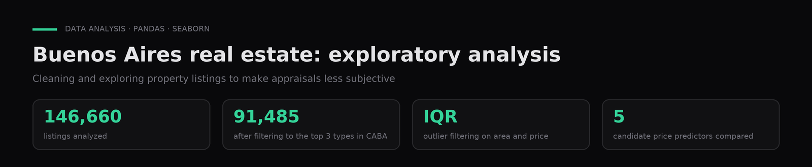

# Buenos Aires real estate, exploratory analysis

**EDA of 146,660 property listings to help appraisers value homes with less subjectivity.**

`Python` · `pandas` · `Seaborn` · `Matplotlib` · [Leer en español ↓](#español)

---

## Problem

Property appraisal is slow and subjective.

## Data

Property listings published in 2019–2020 (the Properati dataset used in the course). The CSV is not included in the repo.

## Approach

Cleaning, IQR-based outlier filtering on area and price, and correlations by property type.

## Results

For the 3 most-listed property types in Buenos Aires City (91,485 listings), rooms and bedrooms are the best individual price predictors, with moderate correlation.

| Property type | Listings |
|---|---|
| Apartment | 107,326 |
| House | 21,521 |
| PH (horizontal property) | 14,298 |
| Land | 1,312 |
| Office | 658 |
| Other (5 types) | 1,545 |

## How to run

1. `pip install -r requirements.txt`.
2. Save the listings CSV as `data/Inmobiliaria.csv` and run `notebooks/real_estate_eda.ipynb`.

## Context

Coursework for **Professional Practicum I** in the AI & Data Science program (Colegio Universitario IES · Universidad Siglo 21, 2024). Author: **Gaspar Quintana**.

---

## Español

**EDA de 146.660 avisos de propiedades para ayudar a los tasadores a valuar con menos subjetividad.**

**Problema.** La tasación de propiedades es lenta y subjetiva.

**Datos.** Avisos de propiedades en venta publicados en 2019-2020 (dataset de Properati usado en el curso). El CSV no se incluye en el repo.

**Método.** Limpieza, filtrado de outliers por rango intercuartílico en superficie y precio, y correlaciones por tipo de propiedad.

**Resultados.** Sobre las 3 tipologías más publicadas de Capital Federal (91.485 avisos), la cantidad de ambientes y de dormitorios son los mejores predictores individuales del precio, con correlación moderada.

**Contexto.** Trabajo de **Práctica Profesionalizante I**, Tecnicatura en IA y Ciencia de Datos (Colegio Universitario IES · Universidad Siglo 21, 2024). Autor: **Gaspar Quintana**.
